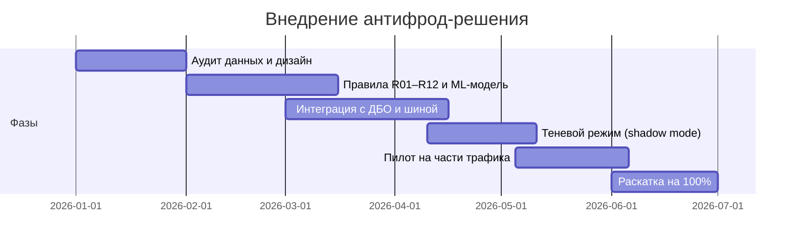

# ROADMAP — внедрение за 6 месяцев, бюджет ≤ 50 млн ₽

## Фазы

### 1. Аудит данных и дизайн (месяц 1) — 6 млн ₽
- **Цели:** карта источников данных и их задержек, требования к шине, дизайн UX трения.
- **Результаты:** каталог признаков, ТЗ на интеграцию, макеты сообщений клиенту, план compliance-ревью.
- **Ответственные:** риск-аналитики, ИТ/интеграции, клиентский опыт/UX, юристы.
- **Риски:** неполнота данных по базам ЦБ; задержки > суток. Митигация: флаг `data_lag`, деградация к правилам.

### 2. Правила R01–R12 и ML-модель (месяцы 2–3) — 16 млн ₽
- **Цели:** реализация 12 обязательных признаков; обучение и калибровка скоринга; пороги low/medium/high.
- **Результаты:** сервис правил, обученная модель, отчёт по качеству на исторических данных.
- **Ответственные:** риск-аналитики (модель), антифрод (правила), ИБ.
- **Риски:** дрейф модели, мало размеченного фрода. Митигация: class_weight, обогащение выборки, мониторинг PSI.
- **Веха:** recall ≥ 95% на истории при FPR ≤ baseline.

### 3. Интеграция с ДБО и антифрод-шиной (месяцы 3–4) — 14 млн ₽
- **Цели:** решение в реальном времени внутри инфраструктуры банка; подключение «Защиты близких».
- **Результаты:** API решений в шине, интерфейсы ДБО, очередь оператора с приоритетами.
- **Ответственные:** ИТ/интеграции, ИБ, антифрод.
- **Риски:** латентность решений; отказ внешних сигналов. Митигация: таймауты, fail-safe в сторону правил.

### 4. Теневой режим / shadow mode (месяцы 4–5) — 4 млн ₽
- **Цели:** решение считает, но не влияет на операции; сверка с текущим антифродом.
- **Результаты:** отчёт о расхождениях, откалиброванные пороги, подтверждение доли ложных срабатываний.
- **Ответственные:** риск-аналитики, антифрод.
- **Веха:** расхождения разобраны, доля ошибочных ограничений (модельно) ниже текущей.

### 5. Пилот на части трафика (месяцы 5–6) — 6 млн ₽
- **Цели:** 5–10% трафика СБП/ДБО, контрольная группа; измерение KPI кейса и NPS.
- **Результаты:** A/B-отчёт, решение о раскатке, обучение операторов и поддержки.
- **Ответственные:** антифрод, поддержка/колл-центр, клиентский опыт.
- **Риски:** рост нагрузки на операторов. Митигация: приоритизация очереди по risk_score.

### 6. Раскатка на 100% трафика (месяц 6) — 4 млн ₽
- **Цели:** полный запуск, мониторинг KPI, процесс переобучения модели.
- **Результаты:** продуктивная эксплуатация, регламент дообучения, отчёт по эффекту.
- **Ответственные:** все подразделения; владелец — антифрод.

**Итого: 50 млн ₽** — согласовано с `src/economics.py` (`check_budget()` проверяет лимит).
