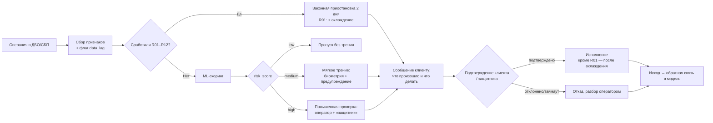

# Процесс: этапы, действия клиента, взаимодействие подразделений

## Схема процесса

## Этапы

1. **Обнаружение** — операция поступает в антифрод-шину, собираются признаки (включая данные с задержкой до суток).
2. **Проверка R01–R12** — обязательные признаки ОД-2506; срабатывание любого → законная приостановка, модель её отменить не может.
3. **ML-скоринг** — только для операций без сработавших признаков: risk_score 0–1 и топ-3 причины.
4. **Решение** — пропуск / мягкое трение / повышенная проверка / законная приостановка.
5. **Коммуникация** — понятное сообщение: что произошло, почему, что делать (см. `src/explain.py`).
6. **Разбор** — оператор антифрода по приоритетной очереди; запрос «защитнику» (таймаут 12 ч → отклонение).
7. **Обратная связь** — исход (подтверждено/отклонено/жалоба) дообучает модель.

## Действия клиента

| Ситуация | Что видит клиент | Что делает |
|---|---|---|
| Низкий риск | Ничего | Платёж проходит как обычно |
| Мягкое трение | Предупреждение о сценарии мошенничества | Подтверждает биометрией (≈1,5 мин) |
| Повышенная проверка | Сообщение о проверке | Ждёт звонка оператора / решения «защитника» |
| Законная приостановка | Уведомление по 161-ФЗ | Подтверждает в один шаг (кроме R01 — охлаждение) |

## RACI

| Этап | Антифрод | UX | Поддержка | ИТ | ИБ | Юристы | Риск-аналитики |
|---|---|---|---|---|---|---|---|
| Правила R01–R12 | A | I | I | R | C | C | C |
| ML-скоринг | C | I | I | R | C | I | A/R |
| Решение и трение | A | R | C | R | C | C | C |
| Коммуникация | C | A/R | R | C | I | C | I |
| Разбор оператором | A/R | I | R | I | C | I | C |
| «Защита близких» | C | R | R | R | I | C | I |
| Обратная связь | C | I | C | R | I | I | A/R |

## Блоки: назначение / вход / выход

См. таблицу в [README.md](../README.md#архитектура-блоков) — источник истины `src/process.py::BLOCKS`.
